# Лабораторная работа №2
## Изучение HTTP-методов и их применения для реализации CRUD-операций

**Выполнил:** Гетогазов Мухаммад Умарович 
**Группа:** ПИЖ-б-о-25-2
**Вариант:** 6 (Студенты) — Средний уровень

---

## 1. Цель работы
Освоить обработку различных HTTP-методов (GET, POST, PUT, DELETE) в Express. Научиться реализовывать CRUD-операции над коллекцией объектов, хранящейся в памяти сервера, а также возвращать корректные HTTP-коды ответов (200, 201, 204, 400, 404). В рамках среднего уровня реализовать поиск, сортировку, пагинацию и валидацию данных.

---

## 2. Теоретическое обоснование

**CRUD** — это акроним, обозначающий четыре базовые операции над данными:
* **Create (Создание)** — HTTP-метод POST.
* **Read (Чтение)** — HTTP-метод GET.
* **Update (Обновление)** — HTTP-метод PUT (полное) или PATCH (частичное).
* **Delete (Удаление)** — HTTP-метод DELETE.

**Идемпотентность** — свойство метода, при котором повторный вызов с теми же данными дает тот же результат. Идемпотентны: GET, PUT, DELETE. Не идемпотентен: POST (создаст дубликат).

**Основные коды ответов:**
* `200 OK` — успешный запрос (GET, PUT).
* `201 Created` — ресурс успешно создан (POST).
* `204 No Content` — успешное удаление (DELETE без тела ответа).
* `400 Bad Request` — ошибка в данных запроса (не прошла валидация).
* `404 Not Found` — ресурс не найден.
* `500 Internal Server Error` — ошибка на стороне сервера.

---

## 3. Выполнение практического примера (Сущность "Товары")

В качестве базового примера реализован CRUD для товаров.

**Код сервера (`app_items.js`):**
```javascript
const express = require('express');
const app = express();
const port = 3001; // Используем другой порт, чтобы не мешал студентам

app.use(express.json());

let items = [
  { id: 1, name: 'Товар 1', price: 100, quantity: 5 },
  { id: 2, name: 'Товар 2', price: 200, quantity: 3 },
  { id: 3, name: 'Товар 3', price: 300, quantity: 10 }
];
let nextId = 4;

// GET все
app.get('/items', (req, res) => {
  res.json({ count: items.length, items: items });
});

// GET один
app.get('/items/:id', (req, res) => {
  const item = items.find(i => i.id === parseInt(req.params.id));
  if (!item) return res.status(404).json({ error: 'Элемент не найден' });
  res.json(item);
});

// POST создать
app.post('/items', (req, res) => {
  const { name, price, quantity } = req.body;
  if (!name || price === undefined) {
    return res.status(400).json({ error: 'Поля name и price обязательны' });
  }
  const newItem = { id: nextId++, name, price, quantity: quantity || 0 };
  items.push(newItem);
  res.status(201).json(newItem);
});

// PUT обновить
app.put('/items/:id', (req, res) => {
  const id = parseInt(req.params.id);
  const index = items.findIndex(i => i.id === id);
  if (index === -1) return res.status(404).json({ error: 'Элемент не найден' });
  
  const { name, price, quantity } = req.body;
  items[index] = {
    id: id,
    name: name || items[index].name,
    price: price !== undefined ? price : items[index].price,
    quantity: quantity !== undefined ? quantity : items[index].quantity
  };
  res.json(items[index]);
});

// DELETE удалить
app.delete('/items/:id', (req, res) => {
  const id = parseInt(req.params.id);
  const index = items.findIndex(i => i.id === id);
  if (index === -1) return res.status(404).json({ error: 'Элемент не найден' });
  
  const deletedItem = items.splice(index, 1)[0];
  res.json({ message: 'Элемент удалён', deleted: deletedItem });
});

app.use((req, res) => res.status(404).json({ error: 'Маршрут не найден' }));

app.listen(port, () => {
  console.log(`Сервер ТОВАРОВ запущен на http://localhost:${port}`);
});
```

**Скриншоты работы эндпоинтов (Товары):**

**1. GET All Items (получение всех товаров)**
*Запрос:* `GET http://localhost:3001/items`
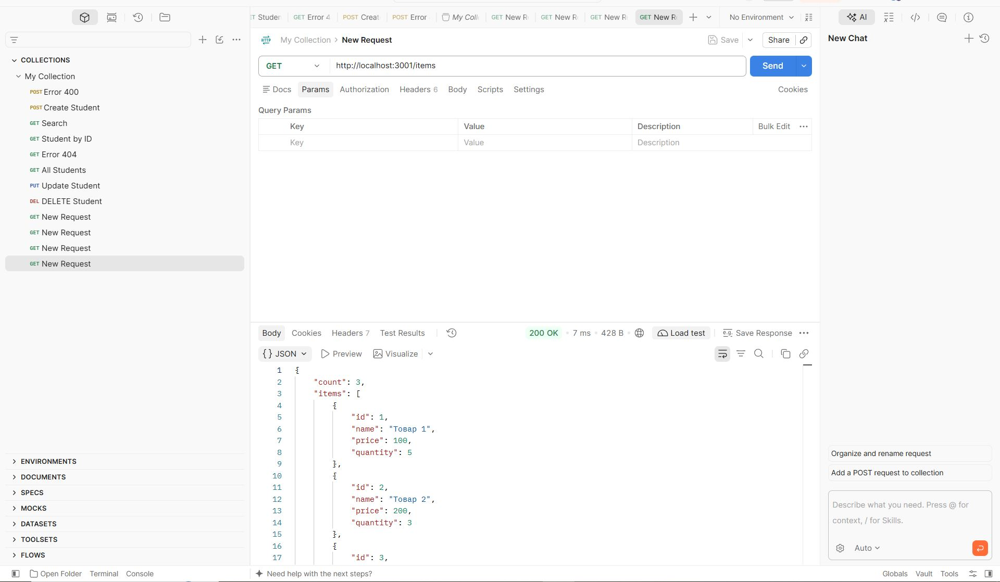

**2. POST Create Item (создание товара)**
*Запрос:* `POST http://localhost:3001/items`
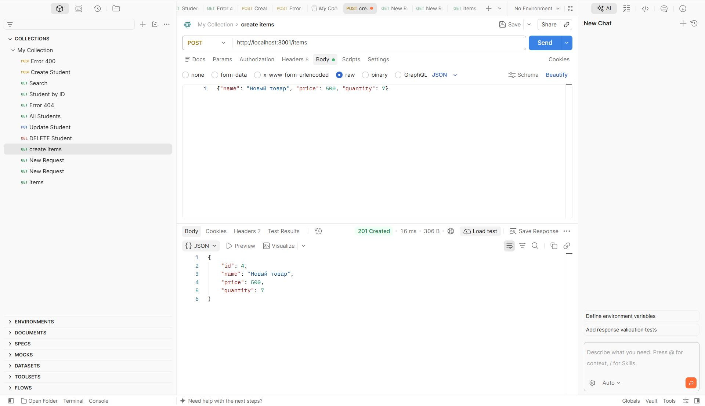

**3. PUT Update Item (обновление товара)**
*Запрос:* `PUT http://localhost:3001/items/1`
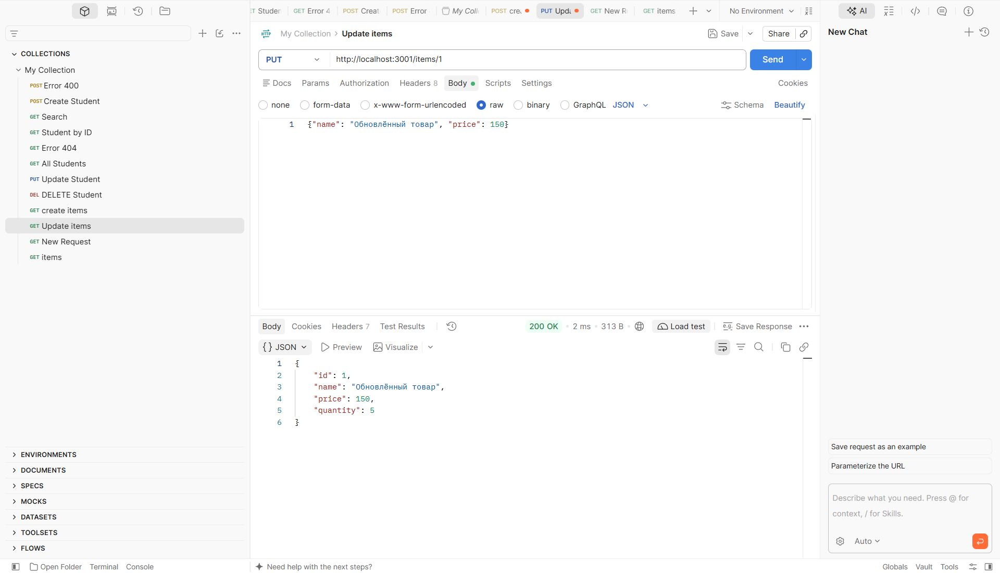

**4. DELETE Item (удаление товара)**
*Запрос:* `DELETE http://localhost:3001/items/3`
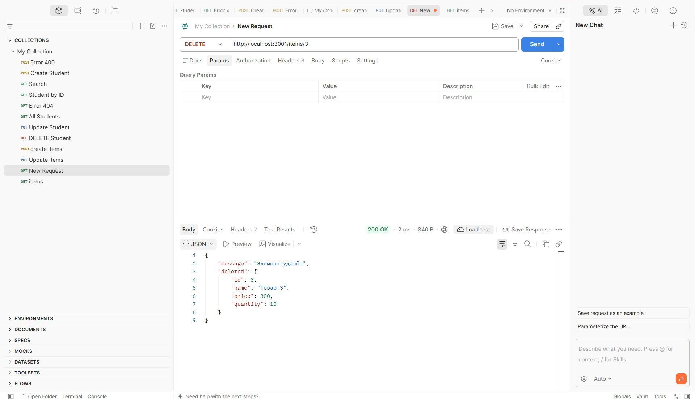

---

## 4. Выполнение индивидуального задания (Вариант 6)

**Сущность:** Студенты (students).
**Поля:** `id`, `name` (имя), `group` (группа).
**Дополнительные требования (Средний уровень):** валидация типов данных, поиск, сортировка, пагинация.

### Код сервера (`app.js`)

```javascript
const express = require('express');
const app = express();
const port = 3000;

// Middleware для парсинга JSON
app.use(express.json());

// Логирование запросов в консоль
app.use((req, res, next) => {
  console.log(`[${new Date().toISOString()}] ${req.method} ${req.url}`);
  next();
});

// ============ ХРАНИЛИЩЕ ДАННЫХ ============
let students = [
  { id: 1, name: 'Магомед Арчаков', group: 'ПИЖ-б-о-25-2' },
  { id: 2, name: 'Мухаммад Гетогазов', group: 'ПИЖ-б-о-25-2' },
  { id: 3, name: 'Давлетмурзав Сайд-Эмин', group: 'ПИЖ-б-о-25-2' },
  { id: 4, name: 'Мержоев Ислам', group: 'ПИЖ-б-о-25-2' }
];

let nextId = 5;

// ============ CRUD-ОПЕРАЦИИ ============

// GET /students – получить всех (с поиском, сортировкой и пагинацией)
app.get('/students', (req, res) => {
  let result = [...students];

  // 1. Поиск по имени (search)
  if (req.query.search) {
    const searchLower = req.query.search.toLowerCase();
    result = result.filter(s => s.name.toLowerCase().includes(searchLower));
  }

  // 2. Сортировка (sort=name&order=asc)
  if (req.query.sort) {
    const sortField = req.query.sort;
    const order = req.query.order === 'desc' ? -1 : 1;
    
    result.sort((a, b) => {
      if (a[sortField] < b[sortField]) return -1 * order;
      if (a[sortField] > b[sortField]) return 1 * order;
      return 0;
    });
  }

  // 3. Пагинация (page=1&limit=10)
  const page = parseInt(req.query.page) || 1;
  const limit = parseInt(req.query.limit) || 10;
  const startIndex = (page - 1) * limit;
  const endIndex = page * limit;

  const paginatedResult = result.slice(startIndex, endIndex);

  res.json({
    total: result.length,
    page: page,
    limit: limit,
    students: paginatedResult
  });
});

// GET /students/:id – получить одного
app.get('/students/:id', (req, res) => {
  const id = parseInt(req.params.id);
  const student = students.find(s => s.id === id);
  
  if (!student) {
    return res.status(404).json({ error: 'Студент не найден' });
  }
  res.json(student);
});

// POST /students – создать
app.post('/students', (req, res) => {
  const { name, group } = req.body;

  // Валидация обязательных полей
  if (!name || !group) {
    return res.status(400).json({ error: 'Поля name и group обязательны' });
  }

  // Валидация типов (что name и group это строки)
  if (typeof name !== 'string' || typeof group !== 'string') {
    return res.status(400).json({ error: 'Поля name и group должны быть строками' });
  }

  const newStudent = {
    id: nextId++,
    name: name.trim(),
    group: group.trim()
  };

  students.push(newStudent);
  res.status(201).json(newStudent);
});

// PUT /students/:id – обновить
app.put('/students/:id', (req, res) => {
  const id = parseInt(req.params.id);
  const index = students.findIndex(s => s.id === id);

  if (index === -1) {
    return res.status(404).json({ error: 'Студент не найден' });
  }

  const { name, group } = req.body;

  if (name !== undefined && typeof name !== 'string') {
    return res.status(400).json({ error: 'Поле name должно быть строкой' });
  }
  if (group !== undefined && typeof group !== 'string') {
    return res.status(400).json({ error: 'Поле group должно быть строкой' });
  }

  students[index] = {
    id: id,
    name: name !== undefined ? name.trim() : students[index].name,
    group: group !== undefined ? group.trim() : students[index].group
  };

  res.json(students[index]);
});

// DELETE /students/:id – удалить (204 No Content)
app.delete('/students/:id', (req, res) => {
  const id = parseInt(req.params.id);
  const index = students.findIndex(s => s.id === id);

  if (index === -1) {
    return res.status(404).json({ error: 'Студент не найден' });
  }

  students.splice(index, 1);
  res.status(204).send(); 
});

// Обработка 404
app.use((req, res) => {
  res.status(404).json({ error: 'Маршрут не найден' });
});

// Запуск
app.listen(port, () => {
  console.log(`Сервер запущен на http://localhost:${port}`);
});

```

### Скриншоты работы эндпоинтов в Postman

**1. Получение всех студентов (с сортировкой и пагинацией)**
*Запрос:* `GET http://localhost:3000/students?sort=name&order=asc&page=1&limit=2`
*Ожидаемый результат:* 200 OK, возвращает 2 записи, отсортированные по имени.

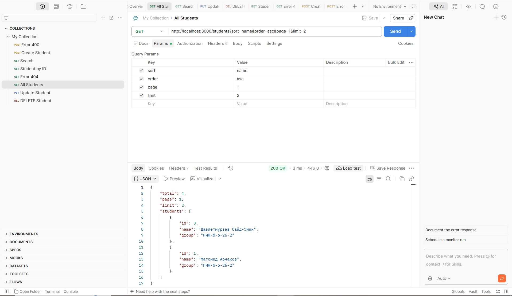

**2. Поиск по имени**
*Запрос:* `GET http://localhost:3000/students?search=Магомед`
*Ожидаемый результат:* 200 OK, возвращает только студентов с именем "Иван".

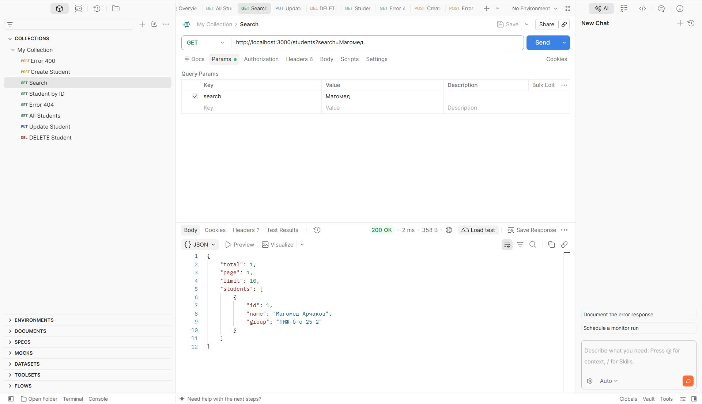

**3. Получение студента по ID**
*Запрос:* `GET http://localhost:3000/students/1`
*Ожидаемый результат:* 200 OK.

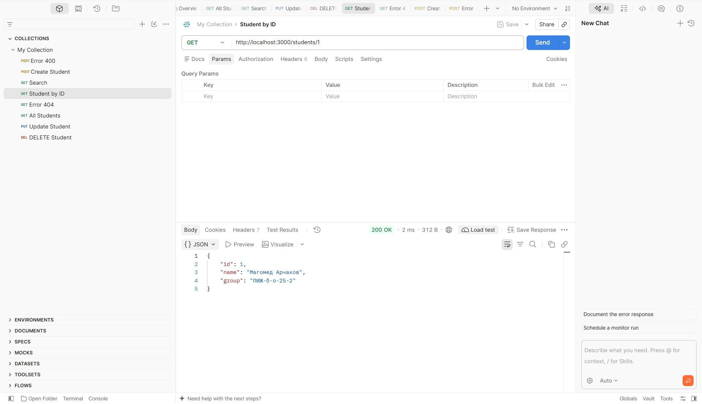

**4. Создание нового студента (с валидацией)**
*Запрос:* `POST http://localhost:3000/students`
*Body (JSON):* `{"name": "Халмышев Мансур", "group": "ПИЖ-б-о-25-2"}`
*Ожидаемый результат:* 201 Created.

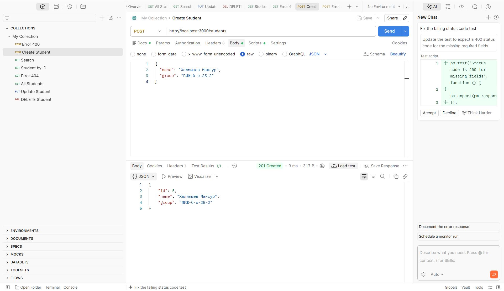

**5. Обновление студента**
*Запрос:* `PUT http://localhost:3000/students/2`
*Body (JSON):* `{"group": "ПИЖ-б-о-25-1"}`
*Ожидаемый результат:* 200 OK.

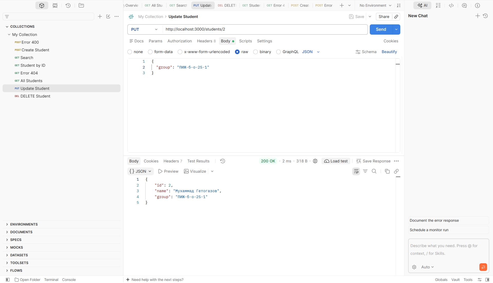

**6. Удаление студента**
*Запрос:* `DELETE http://localhost:3000/students/3`
*Ожидаемый результат:* 204 No Content (тело ответа пустое).

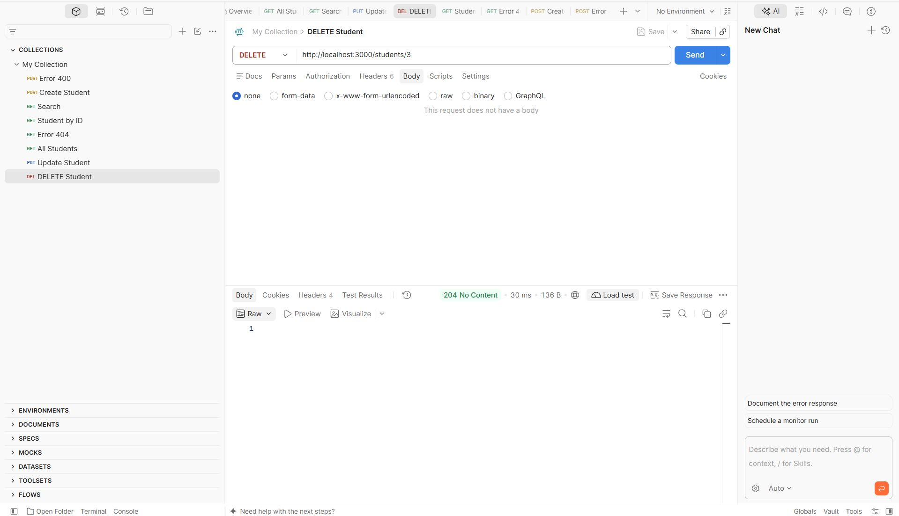

**7. Обработка ошибки 404 (Студент не найден)**
*Запрос:* `GET http://localhost:3000/students/999`
*Ожидаемый результат:* 404 Not Found, JSON с полем `error`.

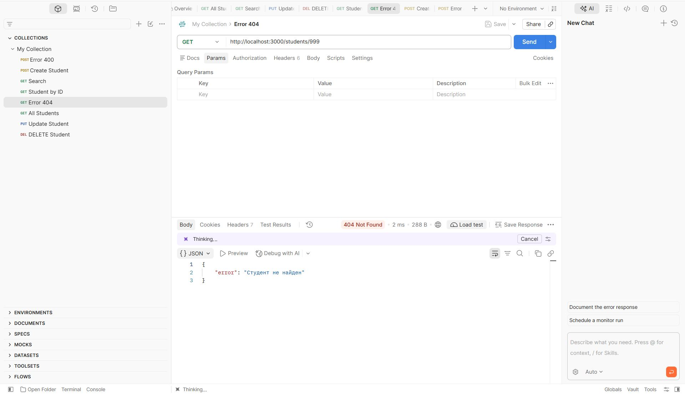

**8. Обработка ошибки 400 (Ошибка валидации)**
*Запрос:* `POST http://localhost:3000/students`
*Body (JSON):* `{"name": 123, "group": "ИС-21"}` (передано число вместо строки)
*Ожидаемый результат:* 400 Bad Request, JSON с сообщением об ошибке.

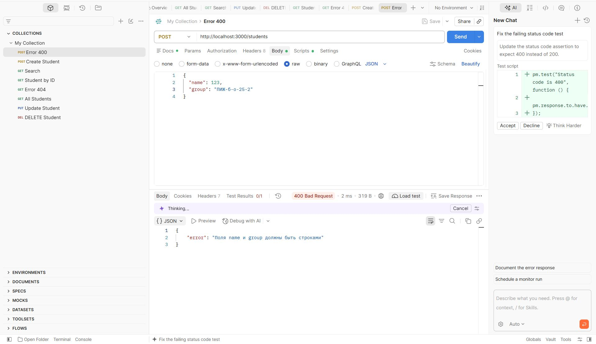

---

## 5. Ответы на контрольные вопросы (Средний уровень)

**1. В чём разница между PUT и PATCH?**
`PUT` используется для полного обновления ресурса (заменяет его целиком). Если вы не передадите какое-то поле, оно будет стерто. `PATCH` используется для частичного обновления — изменяет только те поля, которые были переданы в запросе.

**2. Как реализовать поиск по коллекции (query-параметр search)?**
Нужно получить значение из `req.query.search`, привести его к нижнему регистру и отфильтровать массив с помощью метода `.filter()`, проверяя наличие подстроки в нужном поле (например, `name`).

**3. Как реализовать сортировку по полю?**
С помощью метода массива `.sort()`. В функцию сравнения передается поле, по которому идет сортировка (из `req.query.sort`), и параметр направления `order` (умножаем результат на `1` или `-1` в зависимости от `asc`/`desc`).

**4. Как реализовать пагинацию (постраничный вывод)?**
Нужно получить параметры `page` и `limit` из `req.query`. Вычислить начальный индекс по формуле `(page - 1) * limit` и конечный `page * limit`. Затем использовать метод `.slice(start, end)` для получения нужного куска массива.

**5. Как валидировать входные данные (например, что price — число)?**
Использовать оператор `typeof` для проверки типа данных из `req.body` перед их сохранением. Если тип не совпадает, вернуть ошибку с кодом 400 (Bad Request).

**6. Какие коды ответов используются при ошибках валидации?**
Используется код `400 Bad Request`.

**7. В чём разница между res.json() и res.send()?**
`res.send()` отправляет ответ любого типа (строка, буфер, объект). `res.json()` автоматически устанавливает заголовок `Content-Type: application/json` и преобразует переданный объект в JSON-строку.

---

## 6. Вывод
В ходе выполнения лабораторной работы я изучил принципы построения REST API. Я реализовал сервер на Express.js для сущности «Студенты» (средний уровень сложности). Были добавлены валидация входных данных, поиск по имени, сортировка и пагинация. Также я научился использовать Postman для тестирования API, проверки кодов ответов (200, 201, 204, 400, 404) и экспорта коллекций запросов. В процессе работы возникли сложности с запуском сервера из-за отсутствия Node.js, а также с настройкой тела запроса в Postman для методов POST и PUT, но они были успешно решены.

---

## 7. Список использованных источников
1. Postman Learning Center - https://learning.postman.com/
2. Документация Express.js - https://expressjs.com/
3. MDN Web Docs: HTTP methods - https://developer.mozilla.org/ru/docs/Web/HTTP/Methods
4. Инструкция по настройке Postman (методические материалы).
