# Лабораторная работа №1: Настройка среды разработки и первый HTTP-сервер

**Студент:** Гетогазов Мухаммад Умарович  
**Группа:** ПИЖ-б-о-25-2  
**Вариант:** 6  
**Технология:** Node.js + Express  
**Уровень:** Средний  
**Дата:** 19.09.2026

---

## Содержание

- [Цель работы](#цель-работы)
- [Теоретическое обоснование](#теоретическое-обоснование)
- [Выполнение практического примера](#выполнение-практического-примера)
- [Выполнение индивидуального задания (Вариант 6)](#выполнение-индивидуального-задания-вариант-6)
- [Контрольные вопросы](#контрольные-вопросы)
- [Вывод](#вывод)
- [Список использованных источников](#список-использованных-источников)

Код app.js
const express = require('express');
const app = express();
const port = 3000;

app.use(express.json());

// Логирование запросов
app.use((req, res, next) => {
  console.log(`[${new Date().toISOString()}] ${req.method} ${req.url}`);
  next();
});

let students = [
  { id: 1, name: 'Иванов Иван', group: 'ИС-21' },
  { id: 2, name: 'Петров Пётр', group: 'ИС-21' },
  { id: 3, name: 'Сидорова Анна', group: 'ПИ-22' },
  { id: 4, name: 'Кузнецов Олег', group: 'ПИ-22' },
  { id: 5, name: 'Смирнова Мария', group: 'ИС-23' }
];

// Оценки студентов (вложенный ресурс)
const grades = [
  { id: 1, studentId: 1, subject: 'Математика', grade: 5 },
  { id: 2, studentId: 1, subject: 'Физика', grade: 4 },
  { id: 3, studentId: 2, subject: 'Математика', grade: 3 },
  { id: 4, studentId: 3, subject: 'Программирование', grade: 5 },
  { id: 5, studentId: 4, subject: 'Базы данных', grade: 4 }
];

// 1. GET /students — все студенты
app.get('/students', (req, res) => {
  res.json({ count: students.length, students });
});

// 2. GET /students/:id — один студент
app.get('/students/:id', (req, res) => {
  const id = parseInt(req.params.id);

  // 400 — нечисловой id
  if (isNaN(id)) {
    return res.status(400).json({ error: 'ID должен быть числом' });
  }

  const student = students.find(s => s.id === id);

  // 404 — не найден
  if (!student) {
    return res.status(404).json({ error: 'Студент не найден' });
  }

  res.json(student);
});

// 3. GET /students/:id/grades — вложенный ресурс (оценки студента)
app.get('/students/:id/grades', (req, res) => {
  const id = parseInt(req.params.id);

  if (isNaN(id)) {
    return res.status(400).json({ error: 'ID должен быть числом' });
  }

  const student = students.find(s => s.id === id);
  if (!student) {
    return res.status(404).json({ error: 'Студент не найден' });
  }

  const studentGrades = grades.filter(g => g.studentId === id);

  res.json({
    student: student.name,
    group: student.group,
    count: studentGrades.length,
    grades: studentGrades
  });
});

// 4. GET /groups/:group/students — студенты группы
app.get('/groups/:group/students', (req, res) => {
  const group = req.params.group;

  const filtered = students.filter(
    s => s.group.toLowerCase() === group.toLowerCase()
  );

  res.json({
    group,
    count: filtered.length,
    students: filtered
  });
});

// 404 
app.use((req, res) => {
  res.status(404).json({ error: 'Маршрут не найден' });
});

app.listen(port, () => {
  console.log(`Сервер запущен на http://localhost:${port}`);
});

Скрины кода 

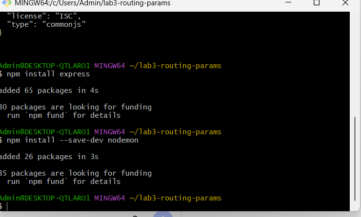
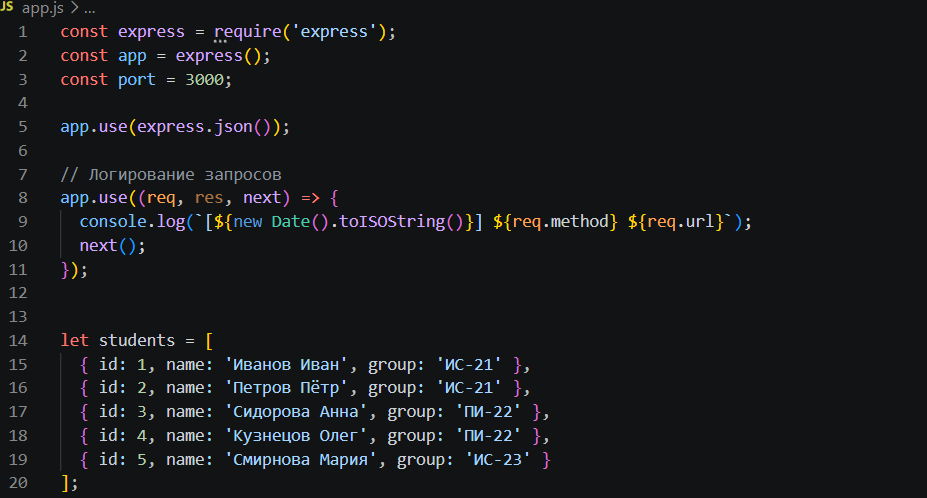
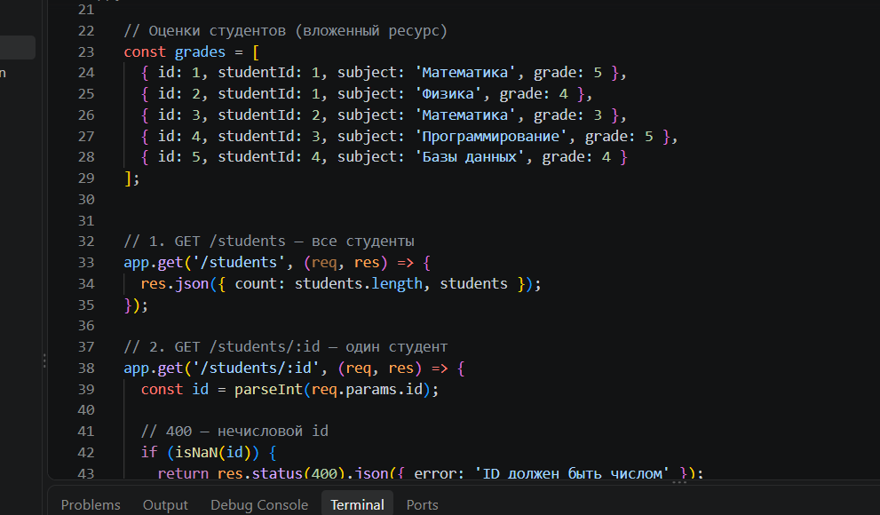
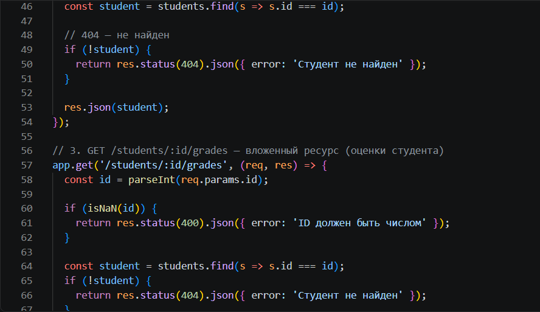
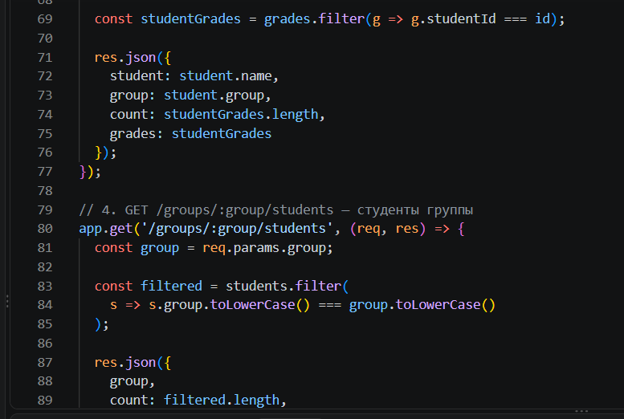
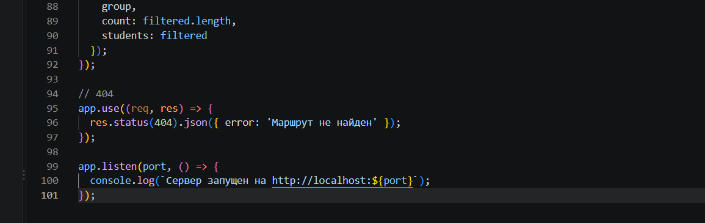
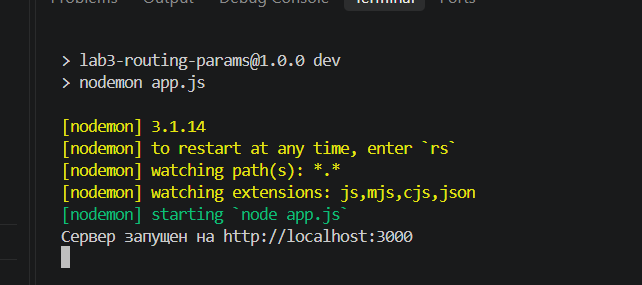
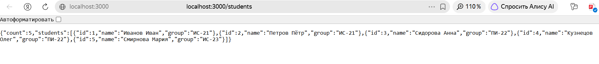
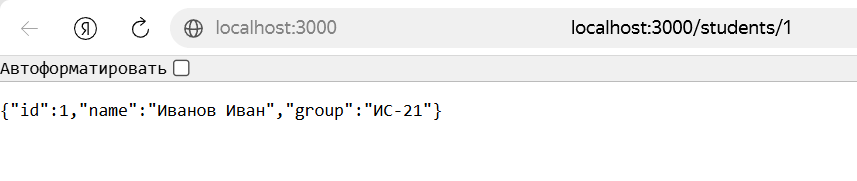
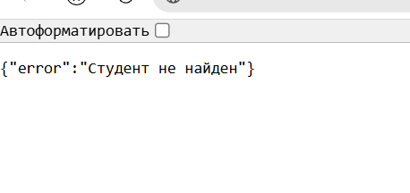
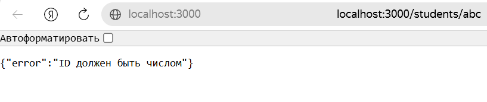
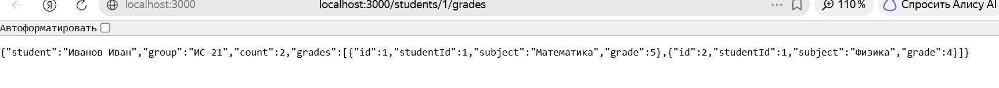
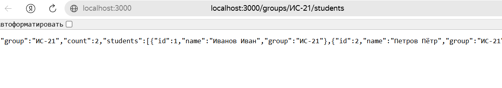
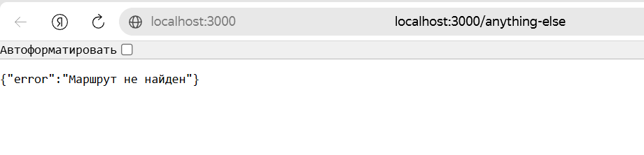

Контрольные вопросы 

## 5. Ответы на контрольные вопросы

**1. Что такое маршрутизация? Как она работает в Express/Flask?**
Маршрутизация — это механизм определения того, как сервер будет отвечать на клиентский запрос к определенному URL (адресу). В Express маршруты создаются с помощью методов объекта `app` (например, `app.get()`, `app.post()`), где указывается путь и функция-обработчик. Во Flask маршруты задаются с помощью декораторов над функциями (например, `@app.route('/students')`).

**2. Чем отличаются `req.params`, `req.query` и `req.body`?**
- **`req.params`** — это параметры пути. Они являются частью самого URL-адреса (например, в адресе `/students/42` параметром будет `42`). Используются для идентификации конкретного ресурса.
- **`req.query`** — это query-параметры. Они идут в URL после знака вопроса `?` (например, `/students?group=IS-21`). Используются для фильтрации, сортировки или поиска.
- **`req.body`** — это тело запроса. Данные передаются скрыто от URL (обычно в формате JSON) и используются в методах POST, PUT, PATCH для создания или обновления ресурса.

**3. Как получить параметр пути в Express? Во Flask?**
- **В Express:** Параметры пути доступны через объект запроса: `const id = req.params.id;`.
- **Во Flask:** Параметр передается в качестве аргумента в функцию-обработчик. Если маршрут задан как `@app.route('/students/<int:student_id>')`, то в функции он принимается так: `def get_student(student_id):`.

**4. Что произойдёт, если не преобразовать параметр пути в число?**
Все параметры пути в Express по умолчанию приходят в виде строк (даже если в URL написаны цифры). Если не использовать `parseInt()`, а попытаться найти элемент в массиве строгим сравнением (`===`), например `student.id === id`, то результат всегда будет ложным (строка `"1"` не равна числу `1`). Сервер не найдет ресурс и вернет ошибку 404, хотя он существует.

**5. Как обработать ситуацию, когда параметр пути отсутствует?**
Если параметр пути не передан (например, запрос идет на `/students/` вместо `/students/42`), сервер не сможет сопоставить его с маршрутом `/students/:id`. В этом случае сработает либо маршрут для общего списка (если он объявлен как `/students`), либо сервер вернет ошибку **404 Not Found**, так как запрашиваемый маршрут не существует.

